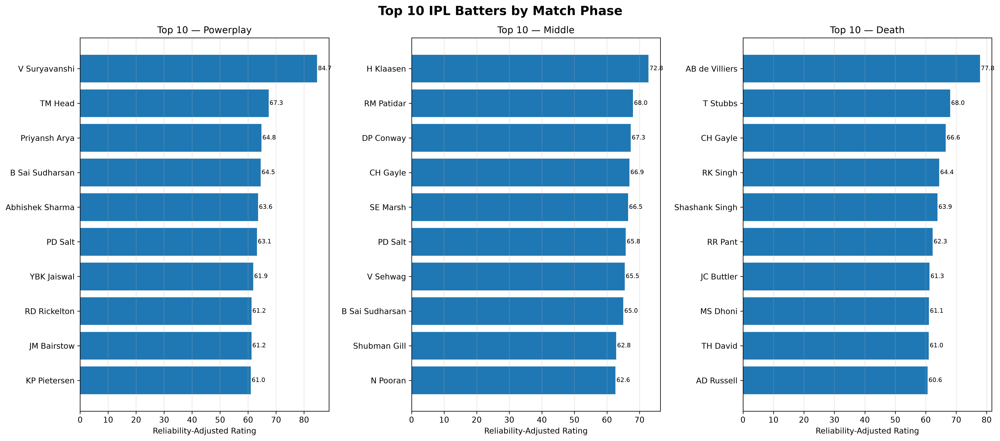
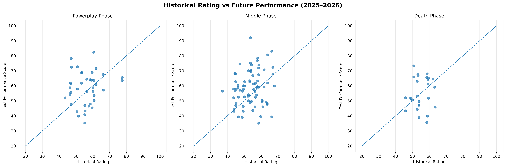
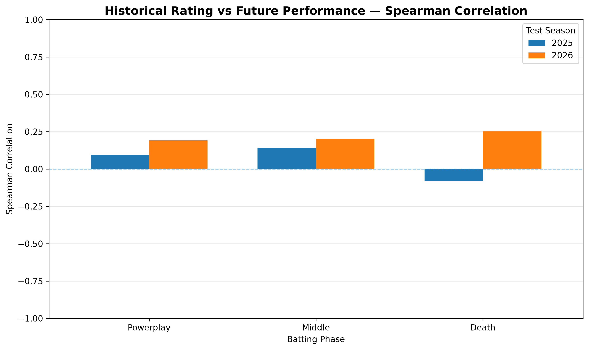
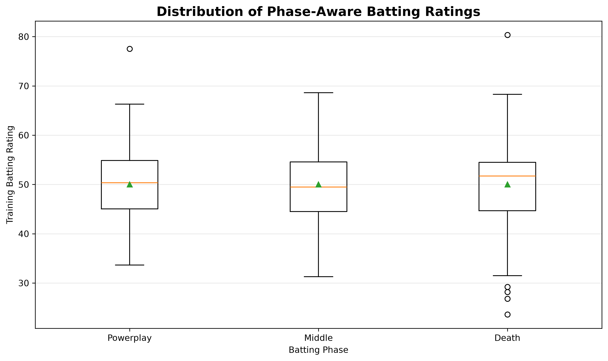

# 🏏 IPL Cricket Analytics & Strategy Intelligence

### From cricket deliveries to data-driven player insights

> **Cricket is often judged by the final score. But what if the real story is hidden in every delivery?**

A batter who dominates the Powerplay may struggle during the middle overs. Another player may score fewer runs but become extremely valuable during the death overs. Some players build innings, while others change the momentum of a match within a few deliveries.

Traditional scorecards tell us *what happened*. But looking deeper into ball-by-ball data can help us understand *how*, *when*, and *why* it happened.

This project explores IPL cricket through data analytics, statistical analysis, and phase-aware player performance evaluation. The goal is to move beyond total runs and strike rates and explore how player contributions differ across the three major phases of a T20 innings.

---

## 📖 01. The Story Begins: Understanding the Game in Phases

A T20 innings is not played in the same way from the first over to the last.

Each phase has a different strategic purpose:

| Match Phase | Overs | What matters? |
|---|---:|---|
| Powerplay | 0–5 | Fast starts, attacking batting, and field restrictions |
| Middle Overs | 6–14 | Building innings, maintaining momentum, and managing wickets |
| Death Overs | 15–19 | Accelerating scoring, boundary hitting, and finishing strongly |

A batter's overall statistics may hide these differences.

For example:
- A player may have an excellent overall strike rate because of strong Powerplay performances.
- Another may be particularly effective at accelerating during the final overs.
- A player with fewer runs may still provide significant value in a specific phase.

**The central question of this project is:**

*Can we evaluate IPL batters more meaningfully by considering the phase in which they perform rather than relying only on overall batting statistics?*

---

## 🎯 02. Project Objectives

The project focuses on the following objectives:

1. Explore historical IPL ball-by-ball data.
2. Clean and process delivery-level cricket records.
3. Divide innings into Powerplay, Middle Overs, and Death Overs.
4. Calculate phase-wise batting statistics.
5. Develop an experimental phase-aware batting rating.
6. Adjust player ratings to account for differences in sample size and reliability.
7. Evaluate whether historical ratings are associated with future performance.
8. Present findings through charts and analytical outputs.

---

## 📊 03. The Data Behind the Game

The analysis uses historical IPL ball-by-ball data containing individual delivery records and match information.

**Dataset overview**

- Total delivery records: 295,732
- Original columns: 34
- Seasons covered: 2007/08 to 2026
- Unit of analysis: Individual ball-by-ball deliveries

The dataset includes information such as:

- Match and season details
- Batter and bowler
- Delivery and over information
- Batter runs and extra runs
- Wicket and dismissal information
- Match-related metadata

### Data preparation

Before analysis, the dataset was prepared by:

- Converting season values into a consistent format.
- Extracting over numbers from delivery information.
- Assigning each delivery to a match phase.
- Handling dismissal information carefully.
- Calculating batting statistics using cricket-specific rules.

Some important cricket rules were considered:

- Wides are excluded from balls faced.
- No-balls count as balls faced.
- Only batter runs are used for batter scoring statistics.
- Run-outs are credited to the dismissed player, not automatically to the batter.
- Retired hurt is not treated as a dismissal.
- Non-boundary fours and sixes are excluded from boundary counts.

These decisions help make the calculated statistics more representative of actual batting performance.

---

## ⚙️ 04. Turning Deliveries into Insights

The ball-by-ball records were transformed into phase-wise batting statistics.

For each batter and phase, the following metrics were calculated:

| Metric | Meaning |
|---|---|
| Total Runs | Runs scored by the batter |
| Balls Faced | Legal batting deliveries faced, excluding wides |
| Dismissals | Dismissals credited to the batter |
| Batting Average | Runs divided by dismissals |
| Strike Rate | Runs scored per 100 balls |
| Boundary Percentage | Boundary count per 100 balls faced |

The analysis also considers the difference between a batter's performance and the average performance of other eligible batters in the same phase.

This is important because a strike rate that is impressive in one phase may be less exceptional in another.

---

## 🧠 05. Developing a Phase-Aware Batting Rating

The next step was to combine multiple batting metrics into an experimental rating.

### Step 1: Compare performance within each phase

Three performance advantages were calculated:

- Strike-rate advantage
- Batting-average advantage
- Boundary-percentage advantage

### Step 2: Standardize the metrics

Z-scores were calculated separately for each phase.

This makes it possible to compare how far a player's performance is from the average of eligible players in that phase.

### Step 3: Combine the metrics

The experimental rating uses the following weights:

| Metric | Weight |
|---|---:|
| Strike-rate advantage | 40% |
| Batting-average advantage | 40% |
| Boundary advantage | 20% |

The rating is scaled around 50:

- 50 represents the average eligible player in that phase.
- Above 50 indicates above-average performance relative to that phase.
- Below 50 indicates below-average performance relative to that phase.

### Step 4: Adjust for reliability

A player with a small number of dismissals may have an unusually high batting average.

To reduce the influence of small samples, a reliability adjustment was introduced using a prior strength of 10.

The adjusted batting average combines the player's observed average with the phase-level league average.

This produces a reliability-adjusted rating that is less sensitive to extreme averages based on limited dismissal counts.

**Important:** The weights, eligibility threshold, and prior strength are experimental design choices. They are not a validated industry-standard player-rating formula.

---

## 🔬 06. Putting the Rating to the Test

A rating should not be evaluated only by how interesting its rankings look. It should also be tested against performance that was not used to construct it.

For this reason, a temporal validation approach was used.

### Training and testing strategy

| Dataset | Seasons | Purpose |
|---|---|---|
| Training | 2007/08–2024 | Calculate historical baselines and player ratings |
| Testing | 2025–2026 | Evaluate future phase-wise batting performance |

The 2025 and 2026 seasons were excluded from training baselines and standardization calculations.

For evaluation:

1. Historical player ratings were calculated using training data.
2. Future phase-wise batting performance was calculated separately.
3. Players with available historical ratings were matched with their future performance.
4. Spearman and Pearson correlations were used to examine the relationship.

A minimum of 200 balls was used for training eligibility, while a 50-ball threshold was used for test-performance evaluation.

Players without historical ratings were not automatically considered failures. They simply did not meet the training eligibility threshold for that phase.

### Validation results

The combined validation included 143 matched player-phase-season records.

| Phase | Records | Spearman Correlation | p-value |
|---|---:|---:|---:|
| Powerplay | 41 | 0.139 | 0.384 |
| Middle Overs | 75 | 0.170 | 0.145 |
| Death Overs | 27 | 0.029 | 0.887 |
| Overall | 143 | 0.141 | 0.093 |

### What do these results tell us?

The correlations are positive but weak, and none is statistically significant at the conventional 0.05 level.

This means the current rating formula has not demonstrated a reliable relationship with future batting performance.

The results are useful because they highlight an important distinction:

**A rating can describe historical performance without necessarily predicting future performance.**

The combined observations are player-phase-season records, not 143 unique players. Some players appear in both test seasons, so the observations may not be fully independent.

Further testing with more seasons, improved rating design, and stronger validation methods is needed before making predictive claims.

---

## 📈 07. What Did the Analysis Reveal?

The historical analysis produced phase-specific player rankings.

Some examples from the full-history reliability-adjusted ratings:

| Phase | Top-ranked Batter | Rating |
|---|---|---:|
| Powerplay | V Suryavanshi | 84.66 |
| Middle Overs | H Klaasen | 72.77 |
| Death Overs | AB de Villiers | 77.80 |

These rankings are based on the full-history dataset and are separate from the temporal validation experiment.

They demonstrate why phase-specific analysis can provide a different perspective from overall batting statistics.

### Visual exploration

**Top 10 batters by phase**



**Historical rating vs future performance**



**Spearman correlation comparison**



**Phase-wise rating distribution**



---

## 💡 08. Key Learnings

Working on this project provided practical experience in:

- Processing large ball-by-ball datasets using Pandas.
- Understanding and applying domain-specific cricket rules.
- Feature engineering from delivery-level records.
- Aggregating statistics at player and match-phase levels.
- Using statistical standardization and weighted scoring.
- Applying reliability adjustments to performance metrics.
- Designing a temporal training and testing split.
- Evaluating results using correlation and p-values.
- Communicating analytical findings through visualizations.

One of the biggest learnings was that **a well-designed analytical metric still needs independent validation**. Interesting rankings alone are not sufficient evidence of predictive value.

---

## 🛠️ 09. Technology Stack

| Technology | Usage |
|---|---|
| Python | Core analysis |
| Pandas | Data cleaning and manipulation |
| NumPy | Numerical calculations |
| Matplotlib | Data visualization |
| Jupyter Notebook | Interactive analysis |
| Git & GitHub | Version control and project hosting |

---

## 📁 10. Project Structure

```text
IPL-Cricket-Analytics/
│
├── Data/
│   └── Raw IPL datasets (kept locally)
│
├── Notebook/
│   ├── Day1_Dataset_Inspection.ipynb
│   ├── IPL_Python_Analysis.ipynb
│   └── Phase_Aware_Player_Rating.ipynb
│
├── Outputs/
│   ├── Charts/
│   │   ├── historical_vs_future_performance.png
│   │   ├── phase_rating_distribution.png
│   │   ├── spearman_correlation_comparison.png
│   │   └── top_10_batters_by_phase.png
│   │
│   ├── combined_validation_summary.csv
│   ├── phase_aware_batting_ratings.csv
│   ├── phase_aware_temporal_validation.csv
│   └── temporal_validation_correlations.csv
│
└── .gitignore
```

The raw dataset is intentionally excluded from this repository. The notebooks and generated analytical outputs are included.

---

## 🚀 11. How to Explore the Project

1. Clone this repository:

```bash
git clone https://github.com/sanikap329-glitch/IPL-Cricket-Analytics.git
```

2. Move into the project directory:

```bash
cd IPL-Cricket-Analytics
```

3. Install the required libraries:

```bash
pip install pandas numpy matplotlib jupyter
```

4. Place the source IPL dataset in the appropriate local `Data/` directory.

5. Launch Jupyter Notebook:

```bash
jupyter notebook
```

6. Open the notebooks in the `Notebook/` directory and run the analysis.

**Note:** The raw dataset is not included in this repository. The source data must be obtained separately and placed at the path expected by the notebooks.

---

## 🔭 12. Future Scope

This project can be extended in several directions:

- Develop more robust phase-aware player evaluation metrics.
- Explore bowling performance across match phases.
- Include match context such as wickets remaining and required run rate.
- Compare player performance across different seasons.
- Explore player roles and team strategy.
- Test ratings on additional unseen seasons.
- Investigate alternative statistical and machine-learning approaches.
- Improve validation using methods that account for repeated player observations.

---

## 👩‍💻 About the Project

This project was developed as part of my journey in Data Science, with an interest in applying analytical thinking to real-world sports problems.

It combines cricket domain understanding, Python-based data analysis, statistical evaluation, and visualization to explore how data can reveal patterns that traditional scorecards may overlook.

**Author:** Sanika Pawar

- GitHub: [sanikap329-glitch](https://github.com/sanikap329-glitch)
- LinkedIn: [Sanika Pawar]([https://www.linkedin.com/in/sanika-pawar-683b5532b/]
-Dashboard http://localhost:8501/
---

*Beyond the scoreboard — understanding the game, one delivery at a time.* 🏏
